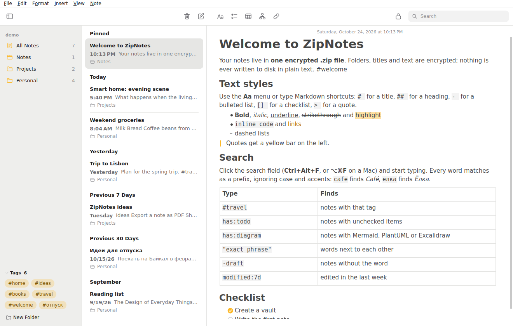
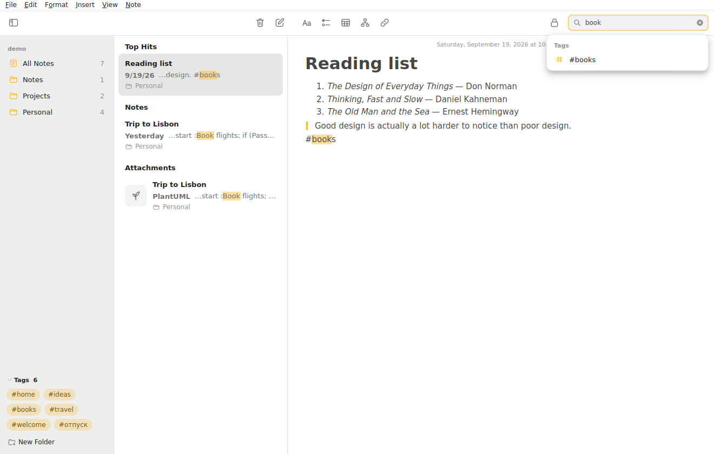
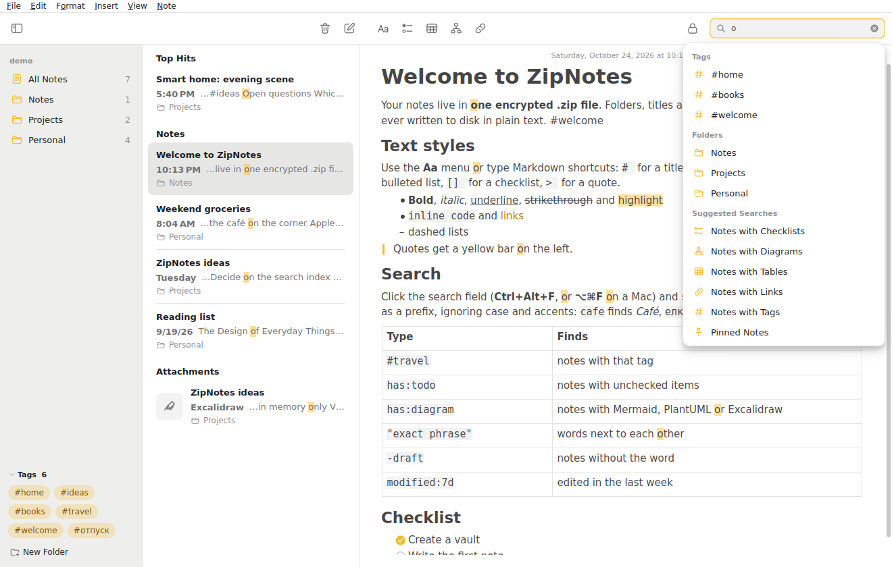
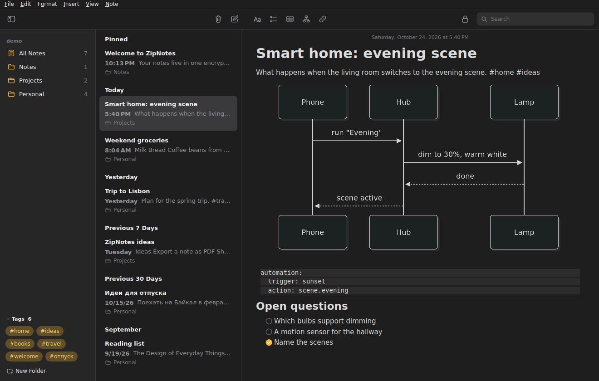
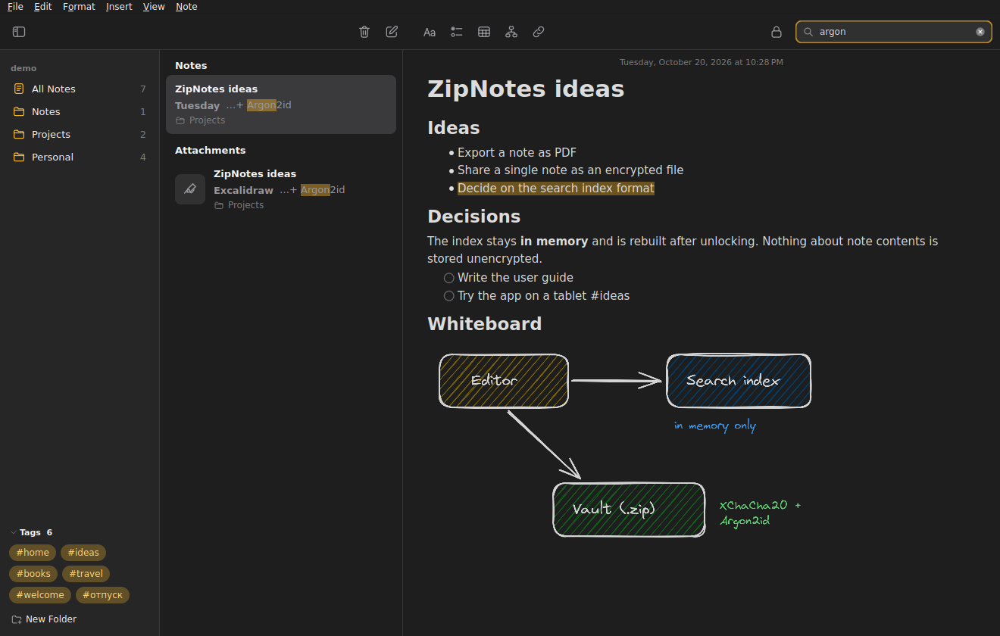
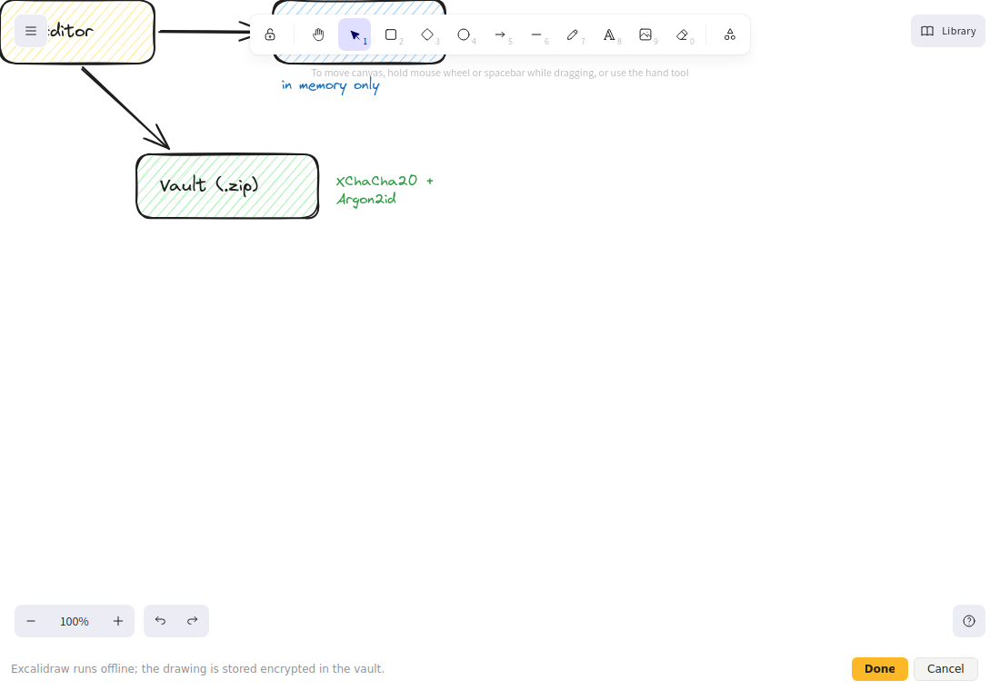
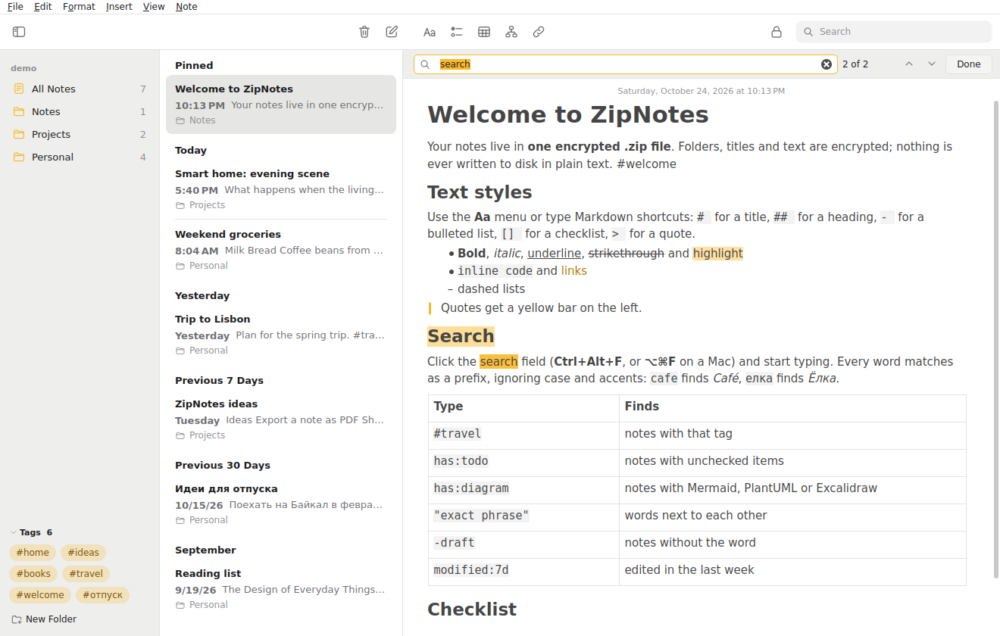

# ZipNotes

A notes app in the spirit of Apple Notes whose notes live **only in an encrypted `.zip` file**. The app opens
the archive like a folder of notes; folders, titles, text, diagrams and drawings inside it are encrypted
(Argon2id + XChaCha20-Poly1305). Nothing is ever written to disk in plain text: not the notes, not the
search index, not temporary files for rendering diagrams.

C++23 · Qt 6 Widgets · libsodium · libzip. Builds on Linux, macOS and Windows.



## Features

**Notes**
- Three panes: folders and tags, the note list (Pinned, Today, Yesterday, Previous 7 Days, Previous 30 Days,
  months, years) and the editor. Light and dark themes.
- Paragraph styles: **Title, Heading, Subheading, Body, Monostyled**, bulleted, dashed and numbered lists,
  **checklists** with round check marks, block quotes. Inline bold, italic, underline, strikethrough,
  highlight, `code` and links; tables, horizontal rules, images.
- Markdown shortcuts while typing: `# `, `## `, `### `, `- `, `* `, `1. `, `[] `, `> `, ```` ``` ````+Return.
- `#hashtags` become a tag cloud in the sidebar (collapsible; with many tags it scrolls instead of
  growing). Pinned notes, Recently Deleted (kept for 30 days), drag and drop into folders, nested folders.

**Search** (design notes: [docs/search.md](docs/search.md))
- Search as you type: every word is a prefix, case- and accent-insensitive (`cafe` finds “Café”,
  `елка` finds “Ёлка”).
- Results in **Top Hits / Notes / Attachments** sections; matches are highlighted in the list and in the
  opened note, which scrolls to the first match.
- When exact matches are scarce, a second, typo-tolerant pass runs (`meetnig` finds “Meeting”).
- Tokens (“chips”) and **Suggested Searches**: tags, folders, notes with checklists, with diagrams,
  edited in the last 7 days…
- Text syntax: `"exact phrase"`, `-exclude`, `#tag`, `folder:Work`,
  `has:todo|checklist|diagram|mermaid|plantuml|drawing|table|link|code|image`, `is:pinned`, `in:trash`,
  `modified:7d|today|2026-10-01`, `before:…`.
- Searches inside diagrams too: Mermaid/PlantUML sources and the text on Excalidraw drawings.
- Find in Note — Ctrl+F.
- The index lives only in memory and is built in the background after unlocking; 5,000 notes are searched
  in about 5 ms.

**Diagrams**
- **Mermaid** — ```` ```mermaid ```` blocks rendered inline (mermaid.js 12, offline).
- **PlantUML** — ```` ```plantuml ```` blocks, rendered by a local `plantuml` or `java -jar plantuml.jar`
  with the SANDBOX security profile. Nothing is sent to a server.
- **Excalidraw** — the full editor (0.17.6, offline) in a window; the scene is stored as an encrypted
  attachment, the note shows a PNG preview, and the drawing’s text is searchable.
- Double-click a diagram to edit it: source on the left, live preview on the right, templates included.
- Rendered diagrams are cached inside the vault (encrypted), so reopening a note needs neither WebEngine
  nor Java.

| | |
|---|---|
|  |  |
|  |  |
|  |  |

## Security

- Password → **Argon2id** (256 MiB, 3 passes) → a key that wraps a random data key. Changing the
  password does not re-encrypt the notes.
- Every entry is **XChaCha20-Poly1305** with the entry name in the associated data. The manifest stores a
  BLAKE2b hash of every entry, so swapping or rolling back a single note is detected.
- Entry names in the archive are UUIDs; note and folder names exist only in the encrypted manifest.
- Locking: toolbar button, Ctrl+L, or automatically after N idle minutes (10 by default). The key lives in
  `sodium_malloc` memory and is wiped.
- Mermaid and Excalidraw run in an off-the-record Qt WebEngine profile whose request interceptor only lets
  `qrc:`, `data:` and `blob:` through — no network.
- Saving is atomic: a temporary file, then `rename`.

Limitations:
- Decrypted note text in process memory is ordinary `QString` data; it is released on lock but not
  zeroed. ZipNotes does not protect against someone who can read the memory of the running process.
- Rolling back the **whole** archive to an older copy is not detected — true of any offline format.
- The number and approximate size of entries are visible. Details: [docs/vault-format.md](docs/vault-format.md).
- A forgotten password cannot be recovered.

## Building

Requirements: CMake ≥ 3.21, a C++23 compiler (GCC 13+, Clang 17+ / Xcode 15+, MSVC 2022), Qt ≥ 6.8
(Core, Gui, Widgets, Svg, Concurrent; WebEngineWidgets and WebChannel for Mermaid and Excalidraw),
libsodium ≥ 1.0.18, libzip.

### macOS

```bash
xcode-select --install                 # once, if the Command Line Tools are missing
scripts/build-macos.sh                 # installs dependencies with Homebrew, builds, runs the tests
open build-macos/ZipNotes.app
scripts/build-macos.sh --bundle        # self-contained .app (Qt inside) and build-macos/ZipNotes.dmg
```

The script installs `cmake ninja pkgconf qt libsodium libzip` from Homebrew. If CMake reports
`Qt WebEngine not found`, the installed Qt has no WebEngine and the app is built without Mermaid and
Excalidraw. PlantUML: `brew install plantuml`. Shortcuts use ⌘ instead of Ctrl on a Mac.
If you copy the `.dmg` to another Mac, macOS may call the app “damaged” because the signature is ad hoc:
`xattr -dr com.apple.quarantine /Applications/ZipNotes.app`.

### Linux / Windows

```bash
# Ubuntu / Debian
sudo apt install cmake ninja-build qt6-base-dev qt6-svg-dev qt6-webengine-dev libsodium-dev libzip-dev
# Windows (vcpkg)
vcpkg install qtbase qtsvg qtwebengine libsodium libzip

cmake -S . -B build -G Ninja -DCMAKE_BUILD_TYPE=Release
cmake --build build
ctest --test-dir build          # 8 test suites
./build/ZipNotes
```

CMake options: `-DZN_WITH_WEBENGINE=OFF` builds without WebEngine (a much smaller binary; Mermaid blocks
show a placeholder, Excalidraw is unavailable, PlantUML still works), `-DZN_BUILD_TESTS=OFF`,
`-DZN_BUILD_APP=OFF`. For a self-contained package use `macdeployqt` / `windeployqt`; both pick up
WebEngine as well.

PlantUML is optional: install `plantuml`, or set the path to `plantuml.jar` in **File ▸ Settings**.

## Running

```bash
ZipNotes                         # start screen: create or open a vault
ZipNotes ~/Notes.zip             # the password screen of this vault
ZipNotes --theme dark            # force the dark theme
```

For screenshots and smoke tests there is a small automation mode. The password is read from an
environment variable, not from the arguments, so it does not show up in the process list:

```bash
ZN_PW=secret ZipNotes demo.zip --password-env ZN_PW --create-demo \
    --steps "search:api;wait:3000" --screenshot shot.png
```

## Keyboard shortcuts

On a Mac, read Ctrl as ⌘.

| | |
|---|---|
| Ctrl+N / Ctrl+Shift+N | new note / folder |
| Ctrl+Alt+F | search all notes |
| Ctrl+F | find in note |
| Ctrl+Shift+T / H / J / B / M | Title / Heading / Subheading / Body / Monostyled |
| Ctrl+Shift+7 / 8 / 9 / L | bulleted / dashed / numbered list / checklist |
| Ctrl+B / I / U, Ctrl+Shift+X, Ctrl+Shift+E, Ctrl+E | bold, italic, underline, strikethrough, highlight, code |
| Ctrl+' | block quote |
| Tab / Shift+Tab, Ctrl+] / Ctrl+[ | list indentation |
| Ctrl+K | link |
| Ctrl+Alt+T / M / U / D | table / Mermaid / PlantUML / Excalidraw drawing |
| Ctrl+Shift+P | pin note |
| Ctrl+L | lock the vault |

## Layout

```
src/core/            no GUI (QtCore + libsodium + libzip only)
  Crypto             Argon2id, XChaCha20-Poly1305, BLAKE2b, keys in sodium_malloc
  Vault, Manifest    the .zip vault format, atomic saves, integrity checks
  TextNormalizer     case and accent folding with an offset map for highlighting
  NoteText           Markdown digest: title, snippet, tags, diagrams, checklists
  SearchQuery        query syntax
  SearchIndex        inverted index, prefixes, typos, BM25, sections, snippets
src/app/
  NoteDocument, MarkdownIO   QTextDocument ⇄ Markdown (own writer)
  NoteEditor, FindBar        editor and Find in Note
  VaultController            unlocking, autosave, trash, background search
  NoteListModel/View, SidebarView, SearchField   list, sidebar, search field with tokens
  DiagramService, WebDiagramRenderer, DiagramEditorDialog, ExcalidrawDialog
resources/web/       host pages mermaid.html and excalidraw.html
third_party/web/     mermaid 12.2.0, Excalidraw 0.17.6, React 18.3.1 (MIT)
```

Tests (`tests/`): crypto, the vault (swapped and tampered entries, tampered KDF parameters), search,
Markdown parsing, the Markdown → document → Markdown round trip, the controller (real Argon2id, reopening,
trash, garbage collection, password change), the editor (typing, checklists, tables, pasting) and the main
window (search focus, folders and tags, new notes). On Linux the tests run with glibc's freed-memory
scribbling enabled, so use-after-free bugs crash instead of passing silently.

## License

MIT, see [LICENSE](LICENSE). Bundled third-party code: mermaid, Excalidraw and React — MIT (license texts
in `third_party/web/*/LICENSE`). Linked libraries: Qt (LGPLv3), libsodium (ISC), libzip (BSD-3-Clause).
